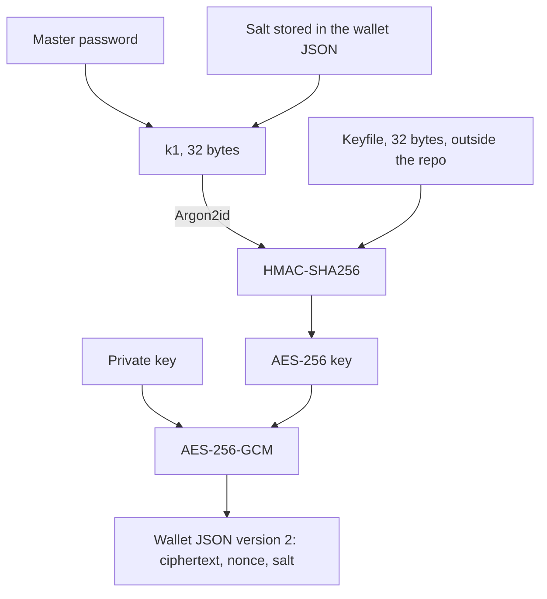
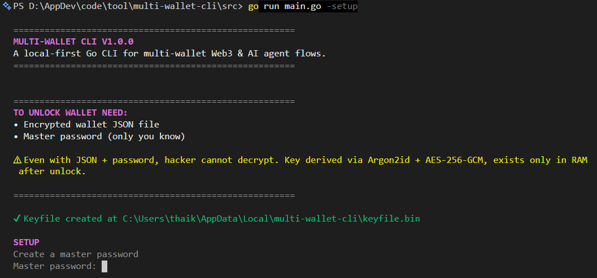
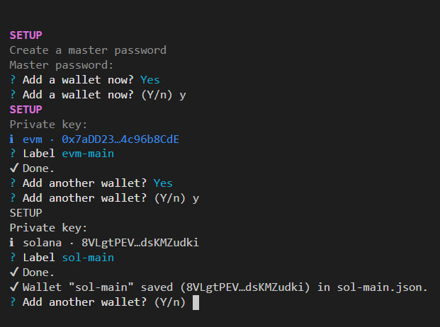
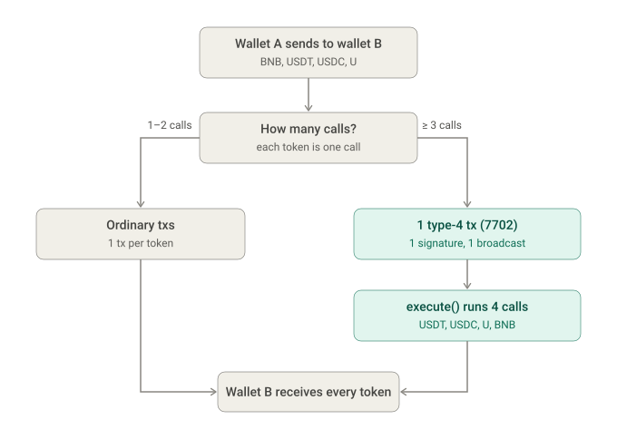
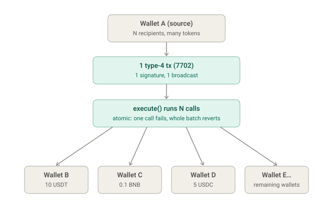
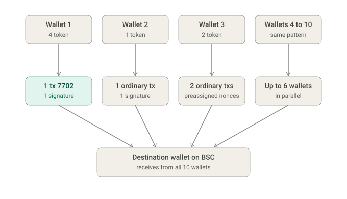
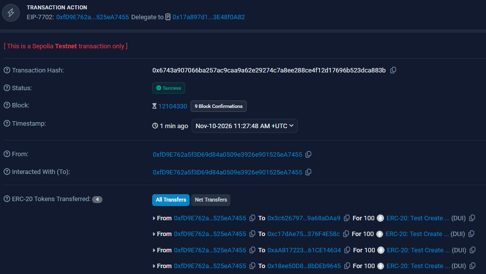

# Multi-Wallet CLI

Local command-line tool for moving funds across many wallets. Keys stay on your machine. An interactive menu and a natural-language agent both stop for your confirmation before anything is signed.

- [Why this tool](#why-this-tool)
- [Tech](#tech)
- [Security](#security)
- [Features](#features)
- [How to use](#how-to-use)
- [Warning](#warning)
- [Deploy the executor](#deploy-the-executor)
- [Disclaimer](#disclaimer)
- [Contributing](#contributing)
- [License](#license)

## Why this tool

> Recorded because numerous major hacks have occurred in the crypto market recently:
>
> - [Binance lost $6.3B](https://www.foxbusiness.com/fox-news-tech/binance-names-new-cfo-days-cryptocurrency-hack) due to social engineering on a DevOps engineer compromising internal tools.
> - [Bitget lost $352M](https://www.cnbc.com/2026/09/25/crypto-platform-bitget-suspects-north-korea-in-352-million-hack.html) due to a backend service breach allowing spoofed transfer requests.
> - [Ledger lost $94M](https://www.forbes.com/sites/digital-assets/2026/10/23/ledgers-spy-chip-attack-what-we-know-so-far) due to a hardware supply-chain spy-chip attack.

Managing multiple on-chain wallets typically relies on browser extensions, hosted bots, or loose script files that store raw private keys insecurely. This local alternative is built to **protect on-chain assets securely** and **explore systems engineering and cryptography**, ensuring you **don't put all your eggs in one basket**.

- One master password unlocks every wallet into RAM. The encrypted JSON alone is not enough.
- Transfer, swap, bridge, and balance run from the terminal across EVM and Solana, without a server account.
- Same-owner EVM transfers batch into one transaction when the chain is ready. Many source wallets still sign separately, in parallel.
- Swap and bridge quotes come from Relay Protocol. You see the plan and confirm it before the CLI signs.
- English and Vietnamese prompts use the same actions.

## Tech

| Piece | Choice |
|---|---|
| Language | Go 1.25 (`src/`) |
| CLI | `survey`, spinner, color. Entry: `src/main.go` |
| Keys | Argon2id, HMAC-SHA256, AES-256-GCM |
| EVM | `go-ethereum` v1.17.10, including type-4 `SetCodeTx` (EIP-7702) |
| Solana | `gagliardetto/solana-go` |
| Swap and bridge | Relay Protocol `POST /quote/v2` |
| Batch transfer | Project executor in `contracts/src/EIP7702Executor.sol`. Address and code hash are pinned per chain in `src/networks.json` |
| Config | JSON files. No database |

## Security

Unlock needs three things. Any one of them missing or wrong makes the AES key wrong, and AES-GCM rejects the file.

1. Master password. You type it at setup and again at each unlock.
2. Keyfile, 32 random bytes, created on first setup and stored outside the repo.
3. Wallet JSON (`version: 2`) with its own salt, nonce, and ciphertext.

Keyfile path:

| OS | Path |
|---|---|
| Windows | `%LOCALAPPDATA%\multi-wallet-cli\keyfile.bin` |
| macOS | `~/Library/Application Support/multi-wallet-cli/keyfile.bin` |
| Linux | `$XDG_CONFIG_HOME/multi-wallet-cli/keyfile.bin`, or `~/.config/multi-wallet-cli/keyfile.bin` |



Unlock reads salt, nonce, and ciphertext from the JSON, loads the keyfile from the path above, and runs the same derivation. `Open` returns the private key only when the tag matches. The CLI allows 5 wrong attempts in that run, then stops. Decrypted keys are wiped from memory on the way out.

The keyfile is not inside the wallet JSON. Copying `src/wallets/*.json` to another machine does not unlock those wallets unless that machine also has the same keyfile.

## Features

### Wallet setup



First run creates the keyfile, asks for a master password, then encrypts each private key you add. EVM and Solana wallets are both supported. Each wallet is its own JSON file.

### Transfer

Screenshots for the menu will be added later. The three modes already follow these diagrams.



One source wallet with three or more calls uses the pinned executor when that chain's `eip7702Executor` and `eip7702ExecutorCodeHash` are set. Below that threshold, or when the pin is empty, the CLI sends ordinary transactions. Many source wallets each sign with their own key, up to 6 at a time. One failed send stops only the rest of that wallet.



You can use the `contracts.eip7702Executor` pins already listed in `src/networks.json`, or deploy your own and write that chain's address + code hash yourself. Full steps: [GUIDE_DEPLOY.md](GUIDE_DEPLOY.md).

### Balance


- Native and known tokens across the chains you pick, for one wallet or all of them.
- Parallel, JSON-RPC-batched reads; optional custom contract address.
- Read-only: no signing.

### Swap and bridge

- Relay builds the route. You confirm the plan, then the CLI signs locally.
- Same-chain swap and cross-chain bridge quote through Relay Protocol `POST /quote/v2`. This repo does not ship a swap or bridge contract.
- Optional destination maps to Relay `recipient`.

### Config

- Language, networks, tokens, and RPC.
- English (default) or Tiếng Việt, applied live; add network or token after a summary confirm.
- Agent provider: Gemini, OpenAI, Claude, or OpenRouter. The API key is entered hidden and stored encrypted.

### Agent

- English or Vietnamese request, then a plan you can confirm, edit, or cancel. The agent never receives the private keys.
- Prompt → LLM function-calling → structured plan (transfer, swap, bridge, balance).
- On confirm, the same app services as the menu run; signing uses in-RAM keys.

## How to use

Install Go 1.25 or newer, then:

```bash
git clone https://github.com/dui14/Multi-Wallet-CLI.git
cd multi-wallet-cli/src
go run main.go -setup
```

Setup writes `keyfile.bin` outside the repo and encrypted wallet files under `src/wallets/`. When it asks, paste a private key and give that wallet a label. Add more wallets in the same run if you want.

Next launches:

```bash
cd src
go run main.go
```

Enter the master password. After five wrong attempts the unlock stops. With the right password the main menu opens: add nothing else before you can transfer, check balances, swap, or bridge.

Wallet JSON and the keyfile are a pair. Back up both, and keep the keyfile out of git.

## Warning

EIP-7702 batch transfer uses a type-4 `SetCode` delegation to the pinned executor. Some wallets (including OKX Wallet) may show a warning or label on that account. Third-party programs may also treat these wallets as sybil. Review every plan; on-chain sends are irreversible.


## Deploy the executor

`EIP7702Executor` is a small self-call batch contract: only the delegated account may run `execute(calls[])`. The CLI enables that path only when both pins are set for the chain.

- Use the addresses already under `contracts` in `src/networks.json`, **or** deploy your own (Sepolia first) with [GUIDE_DEPLOY.md](GUIDE_DEPLOY.md).
- Verify the pin yourself before trusting it:

```bash
cast code <eip7702Executor> --rpc-url <RPC>
cast keccak $(cast code <eip7702Executor> --rpc-url <RPC>)
```

The keccak result must equal `eip7702ExecutorCodeHash` in `networks.json`. A mismatch means do not use that pin.

## Disclaimer

On-chain transfers are irreversible. A wrong address, a wrong code hash, a bad RPC, or a mistaken confirm can lose funds. Review every plan before you sign. This tool stores keys only on your machine; you are responsible for backups, the keyfile, and any contract you pin. The software is provided as-is under the MIT license, without warranty.

## Contributing

See [CONTRIBUTING.md](CONTRIBUTING.md).

## License

[MIT](LICENSE). Copyright (c) 2026 KHANG LUONG.
