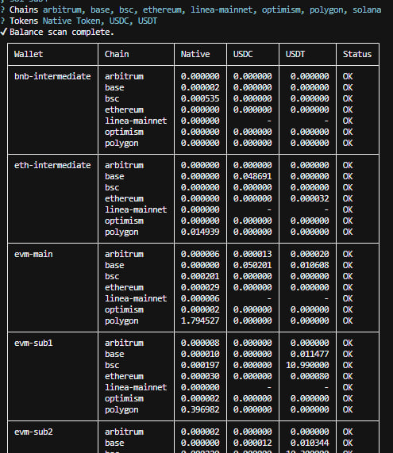
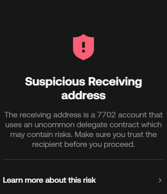

# Multi-Wallet CLI

Local-first Go CLI for transfer, swap, bridge, and balance across multiple EVM and Solana wallets. Keys stay encrypted on disk (Argon2id + AES-256-GCM), unlock into RAM with one master password, and never leave the machine. Interactive menu and a natural-language agent both require confirm before anything is signed.

```bash
git clone https://github.com/dui14/multi-wallet-cli.git
cd multi-wallet-cli/src
go run main.go -setup   # first run
go run main.go          # later runs
```

Requires Go 1.25+. Setup writes `keyfile.bin` outside the repo and encrypted JSON under `src/wallets/`. Back up both; the JSON alone cannot unlock.

## Balance



- Parallel, JSON-RPC-batched reads of native and known tokens (optional custom contract) on the chains you pick.
- Scope is one selected wallet or all wallets; results are a chain × token table with per-cell errors if an RPC fails.
- Read-only: no signing.

## Swap and bridge

- Same-chain swap and cross-chain bridge both quote through Relay Protocol `POST /quote/v2`. This repo does not ship a swap or bridge contract.
- Swap: token → token on one chain. Bridge: same asset A → B, or token A on chain C → token B on chain D.
- Optional destination maps to Relay `recipient`. You review expected amount, fees, and gas, then the CLI signs Relay steps locally.

## Config

- Language: English (default) or Tiếng Việt, applied live.
- Add network / add token into `networks.json` and `tokens.json` after a summary confirm.
- Agent provider: Gemini, OpenAI, Claude, or OpenRouter. The API key is entered hidden and stored encrypted; the agent reads it from RAM after unlock.

## Agent

- English or Vietnamese prompt → LLM function-calling → structured plan (transfer, swap, bridge, balance).
- Plan is a todolist you **Confirm**, **Cancel**, or **Edit**. The model never receives private keys and cannot sign.
- On confirm, the same app services as the menu run; signing uses in-RAM keys.

## Warning

EIP-7702 batch transfer uses a type-4 `SetCode` delegation to the pinned executor. Some wallets (including OKX Wallet) may show a warning or label on that account. Third-party programs may also treat these wallets as sybil. Review every plan; on-chain sends are irreversible.



## Deploy

Same-owner EVM transfers batch through `EIP7702Executor` only when `eip7702Executor` and `eip7702ExecutorCodeHash` are set for that chain in `src/networks.json`. Empty pins keep ordinary transactions.

Do not copy the full procedure here. Follow **[GUIDE_DEPLOY.md](GUIDE_DEPLOY.md)** (Sepolia first, then each chain you need). Verify the pin with `cast code` / `cast keccak` before you trust it.

## License

[MIT](LICENSE). See [CONTRIBUTING.md](CONTRIBUTING.md).
